

# Fieldrig

**A field toolkit for mining, geology, geophysics and mineral processing.** 
Maps and cut & fill, field stations and a stereonet, stakeout, drillhole logging, geophysics reading logs, sample QA/QC, P2H checks and over 45 field calculators, on one Android phone. Works offline.

### ⬇ [Download Fieldrig](https://github.com/zakusworo/fieldrig/releases/latest/download/fieldrig.apk)

Free · no account · no ads · about 11 MB

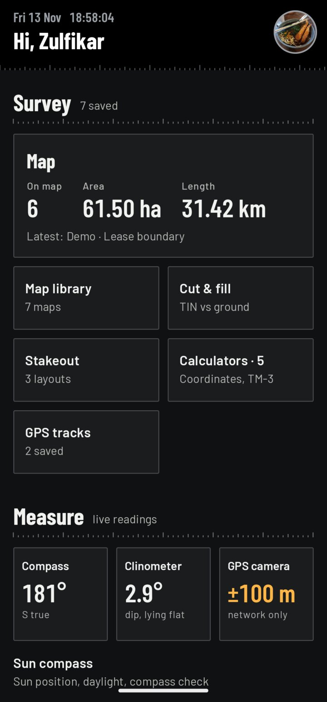&nbsp;
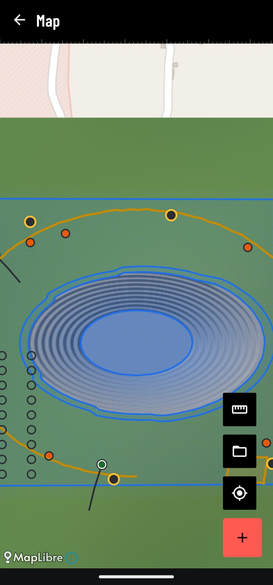&nbsp;
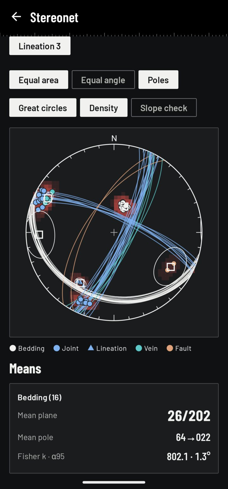&nbsp;
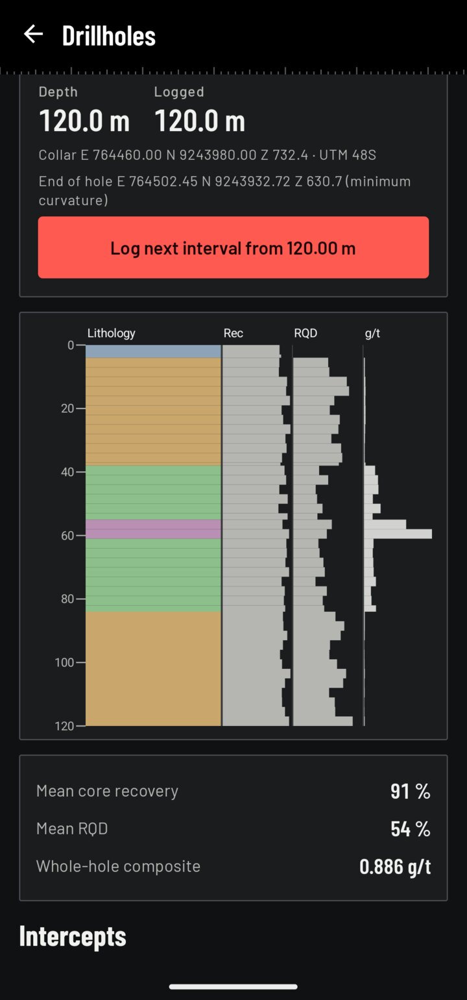

## Install

1. On your Android phone, open the [download link](https://github.com/zakusworo/fieldrig/releases/latest/download/fieldrig.apk).
2. Open the downloaded `fieldrig.apk`. If Android asks, allow your browser or file manager to **install unknown apps** for this one install.
3. Open **Fieldrig**, type your name (no password, nothing leaves the phone) and allow location when asked.

Needs Android 8.0 or newer on a normal (ARM) phone. To update, install the newer APK over the old one: your data stays.

## Try it with the demo data

Open **Settings** (tap your photo or initials, top right) → **Demo data** → **Load demo data**.

This loads a made-up open-pit prospect near Citatah, West Java, with at least two samples for every tool:

- **Maps:** a design pit, the original ground, planned drill collars, a lease boundary, a GeoPDF site plan and an offline hillshade basemap.
- **Field records:** 8 field stations with about 50 structure measurements, 2 stakeout layouts, 3 drillholes and 5 geophysics surveys.
- **Tracks and paperwork:** 2 GPS tracks, 2 lab batches, 2 P2H checks and 2 daily reports.

Every calculator also has two worked examples: tap **Example 1** or **Example 2** at the top. **Remove demo data** takes out only the demo records and leaves your own work alone.

## How to use

Every tool has a **?** button in its title bar with step-by-step instructions, and Home has **How to use Fieldrig**, a handbook of all of them. The same guide is here: **[docs/TUTORIAL.md](docs/TUTORIAL.md)**.

## What's in it

### Survey

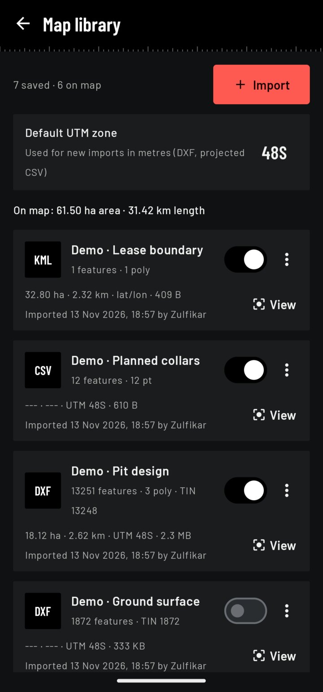&nbsp;
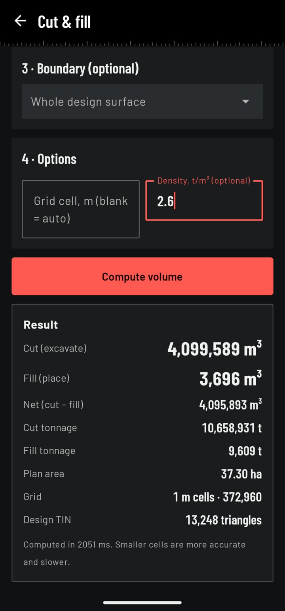&nbsp;
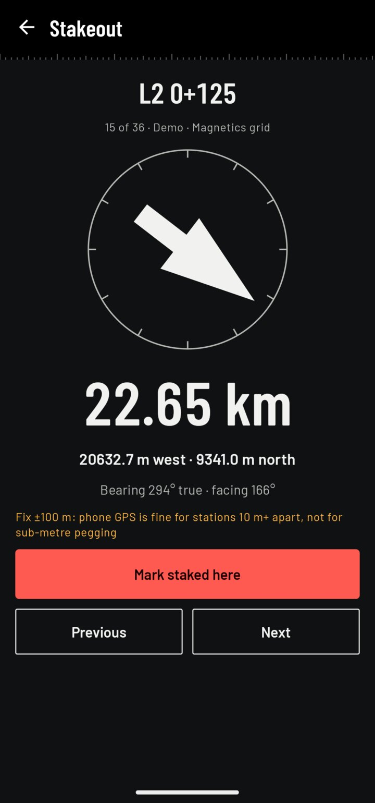&nbsp;
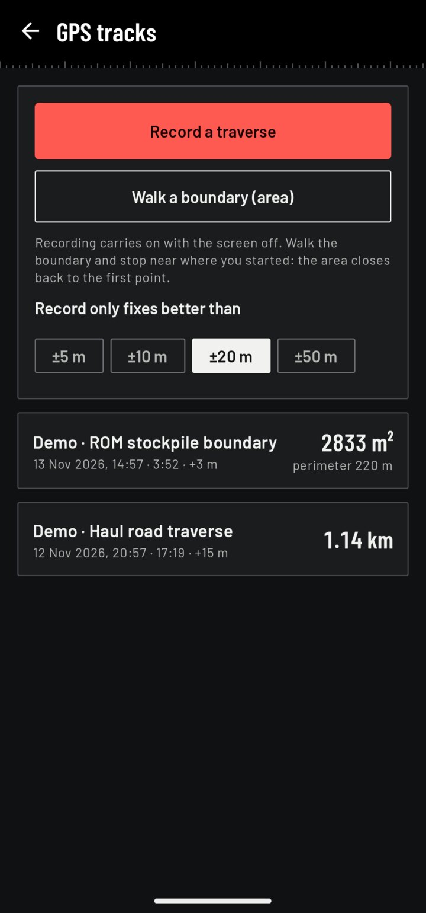

- **Map and map library.** Import DXF (with 3D TIN faces), Surpac STR, KML, CSV (point lists), GeoPDF and plain PDF drawings, and **offline basemaps** (MBTiles or PMTiles raster, for example a drone orthophoto exported from QGIS). Maps stay on the phone and can be switched on and off.
- **Cut & fill.** A design TIN against a flat level or another surface, with an optional boundary and tonnage. On the demo it gives 4.10 million m³, within 0.1 % of the exact volume of the demo surfaces.
- **Stakeout.** Lay out survey lines and grids (true or grid azimuth), or take points from a map, typed coordinates or your stations, then walk to each one. The arrow points relative to where the phone faces. It only says "on point" when the GPS is good enough to tell, and it records where each point was actually pegged.
- **GPS tracks.** Record a traverse, or walk around a boundary to get its area. Recording continues with the screen off. Export as GPX, KML or CSV.
- **Ruler.** On the map, tap points to measure distance, bearing and area.
- **Survey calculators.** Coordinate converter (lat/lon, DMS, UTM and Indonesia's TM-3), distance and bearing, slope units, area from coordinates, and volume from cross-sections.

### Measure

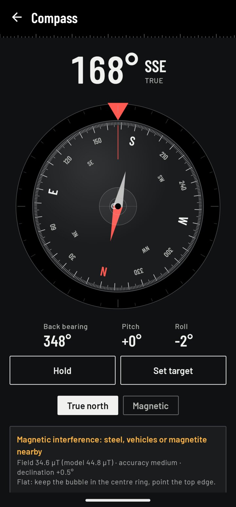&nbsp;
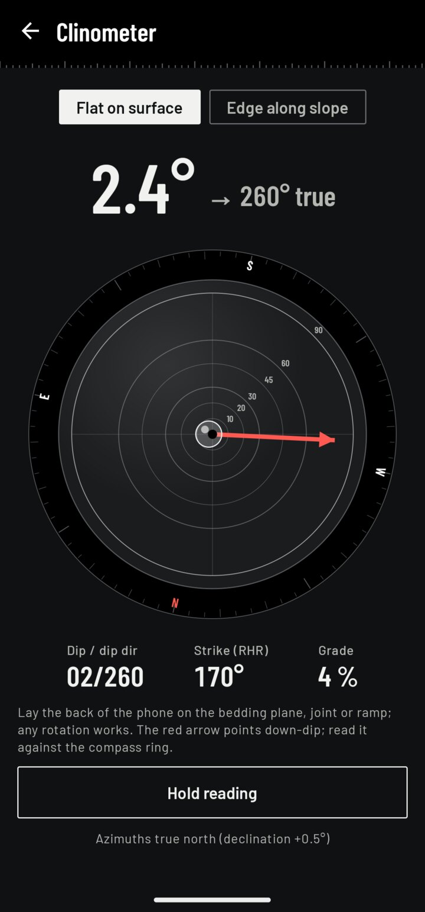&nbsp;
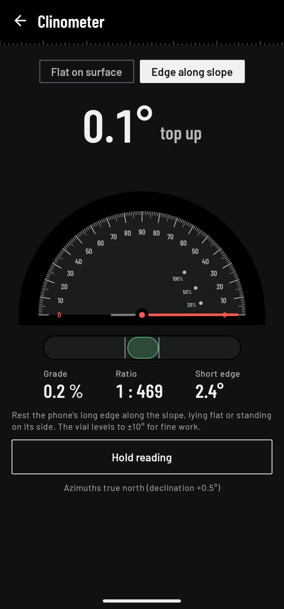&nbsp;
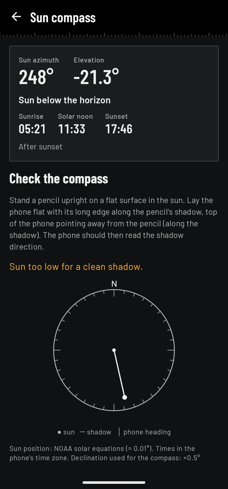

- **Compass.** True or magnetic, flat or sighting, bubble level, back bearing, hold, and a target bearing to walk a line. It warns when steel, vehicles or magnetite disturb the magnetic field, by comparing it with the World Magnetic Model for your position.
- **Clinometer.**
  - Lay the phone on a plane to read dip and dip direction on a bullseye.
  - Run its edge along a slope to read the angle on a protractor.
- **Sun compass.** Where the sun is now, plus sunrise, sunset and daylight left. To check the phone compass, lay it along the shadow of a pencil.
- **GPS camera.** Each photo is stamped with:
  - position (lat/lon and UTM), elevation, accuracy, bearing and tilt;
  - date and time, and the street or village address when there's signal;
  - a QR code that opens the spot in a map app.

### Geology

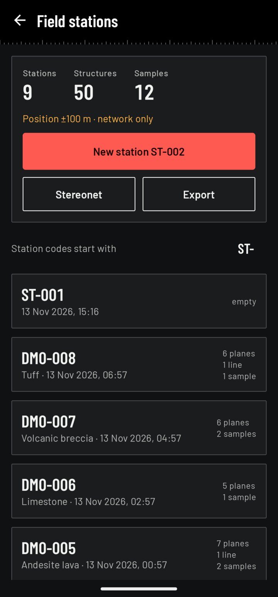&nbsp;
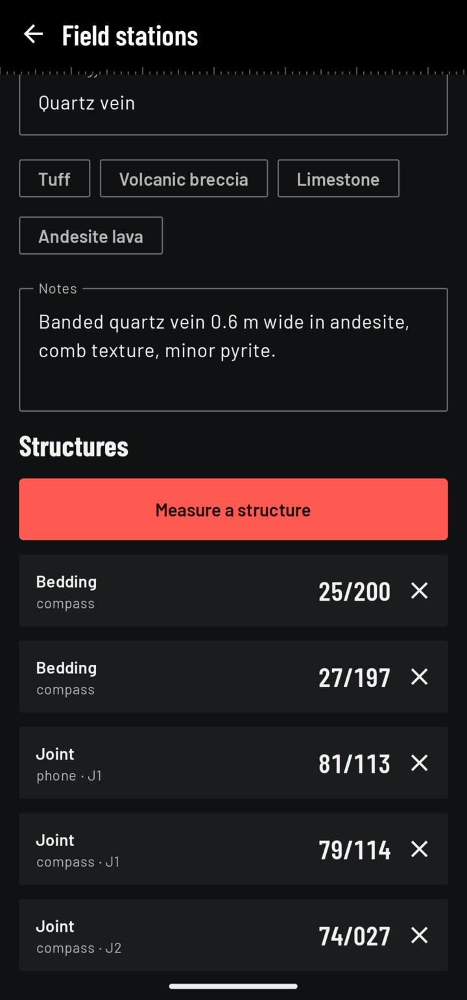&nbsp;
&nbsp;
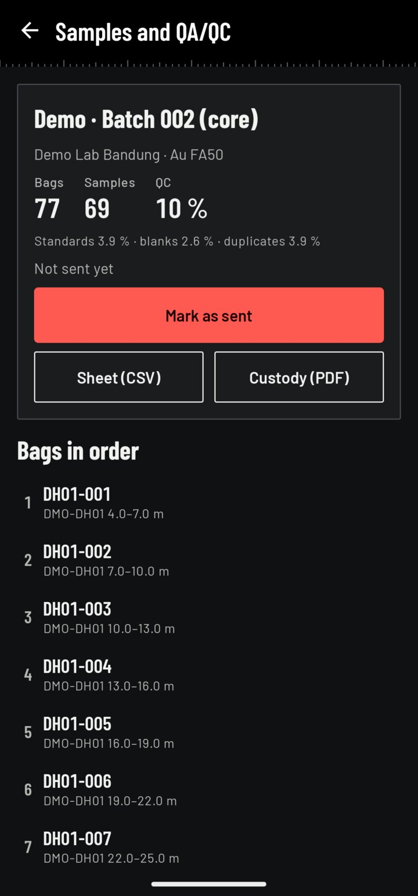

- **Field stations.** GPS position, lithology, notes, photos and samples. Measure structures with the phone, or type compass readings; everything is stored against true north. Export as CSV or KML.
- **Stereonet.** Equal-area or equal-angle nets with poles, great circles and density. It shows Fisher mean and α95, a strike rose, and a slope check for planar, wedge and toppling failure.
- **Drillholes.** Collars, downhole surveys and logged intervals: lithology, recovery, RQD, grade and sample IDs.
  - Strip log, composites and best intercepts above a cut-off.
  - Hole traces on the map.
  - Collar, survey and interval CSVs that import into Leapfrog or Surpac.
- **Samples and QA/QC.** Lab batches with standards, blanks and duplicates inserted at the rates you choose. Export a CSV submission sheet and a printable chain-of-custody PDF.
- **Geology calculators.** Apparent dip, three-point problem, true thickness, RQD, RMR89 and GSI, Q-system, plane intersection, and geothermometers.

### Geophysics

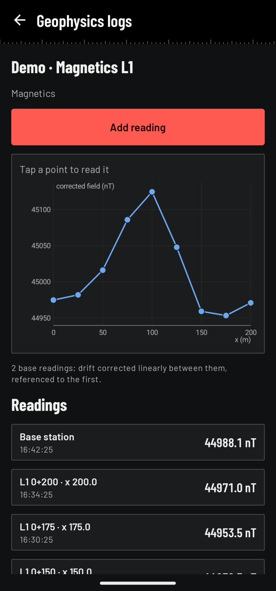&nbsp;
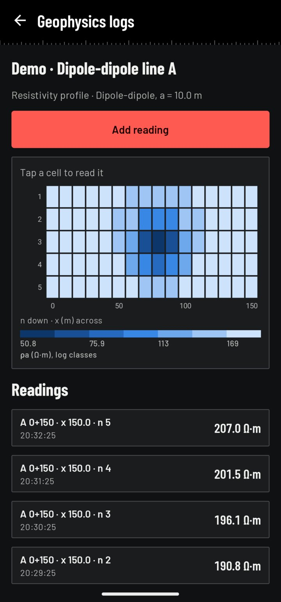&nbsp;
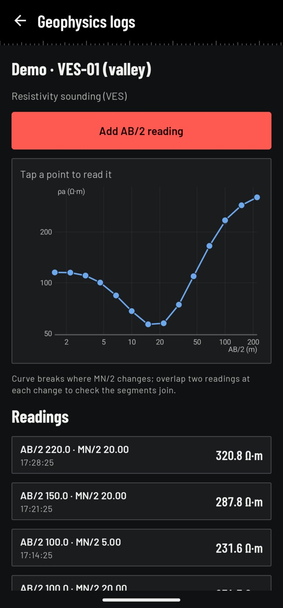

- **Reading logs.** Each reading records the time and GPS position, and can follow a stakeout line.
  - **Magnetics:** corrected for base-station drift, shown as a profile.
  - **Resistivity profiles:** dipole-dipole, pole-dipole or Wenner, shown as a pseudo-section.
  - **VES:** Schlumberger soundings on a log-log curve.
  - **Other readings:** any value you log, shown as a profile.
- **Geophysics calculators.** Apparent resistivity for five arrays, VES electrode spacings, gravity reduction (GRS80), magnetic diurnal correction, seismic refraction depth, GPR depth, and EM skin depth.

### Mining, processing and safety

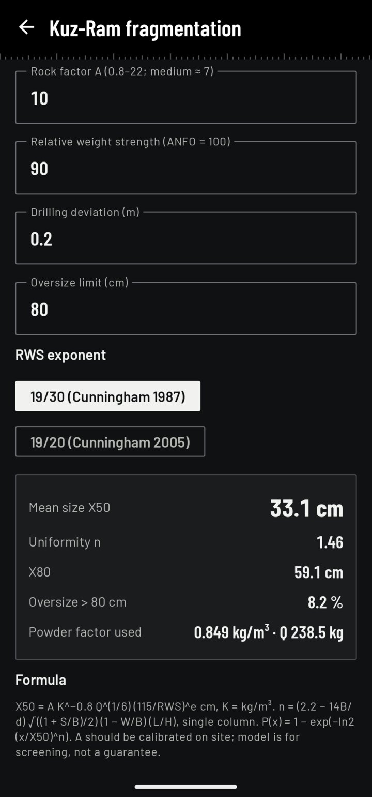&nbsp;
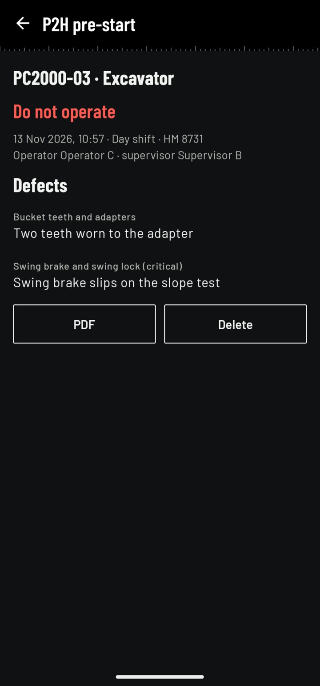&nbsp;
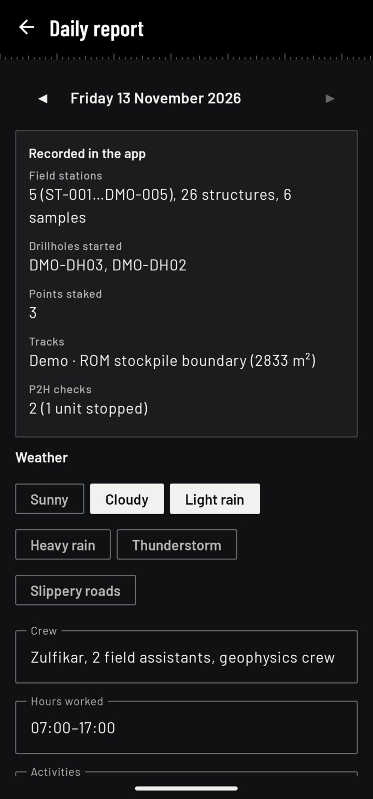

- **Mining calculators.**
  - Blasting: blast design, Kuz-Ram fragmentation, ground vibration (PPV and maximum charge).
  - Production: stockpile volume, equipment availability (MA, PA, UA, EU), cut-off grade, stripping ratio, swell.
  - Slopes and roads: haul road, slope factor of safety (infinite slope, plane failure).
  - Mine water: weir flow, float-method stream flow, runoff and sump volume, settling pond, pump power.
  - Haulage tools: cycle time and matching fleet.
- **Processing calculators.** Two- and three-product recovery, Bond grinding energy, pulp density, reagent dosing, grade units, contained metal, and coal quality basis (ar, adb, db, daf, GCV units, NAR).
- **P2H pre-start checks.** For dump trucks, excavators, dozers, graders, drill rigs and light vehicles. Any critical defect gives "Do not operate". Export a CSV log of all checks, or a PDF of one check with signature lines.
- **Daily report.** Fills itself from the day's stations, holes, readings, staked points, tracks and checks. You add the weather, crew, activities, hazards and tomorrow's plan, and share it as a PDF.
- **Safety calculators.** Heat index and WBGT estimate, and lightning distance.

Each calculator shows the formula and its assumptions under the result. The maths is checked by 79 automated tests against published values and worked examples.

## Good to know

- **GPS accuracy.** A phone's GPS is good to about 3–5 m under open sky. That's fine for stations 10 m or more apart, mapping and photos, but not for sub-metre pegging such as blast holes.
- **Phone compass.** Magnetometers are disturbed by steel, vehicles and magnetite-rich rock. Fieldrig warns you, and the sun compass lets you check against the sun.
- **Offline.** Everything works without signal except the online street map and the address on photos. For no-signal sites, import an offline basemap.
- **Your data stays on your phone.** There's no account, no server and no tracking. Exports go only where you share them. The photo address comes from Android's built-in address lookup.

## Credits

Map data © [OpenStreetMap](https://www.openstreetmap.org/copyright) contributors. Built with [MapLibre Native](https://maplibre.org), [JTS](https://locationtech.github.io/jts/), [ZXing](https://github.com/zxing/zxing) and the [Barlow](https://github.com/jpt/barlow) typeface (OFL). The demo site, its maps and all demo records are made up.

Made by [zakusworo](https://github.com/zakusworo). Problems or ideas: [open an issue](https://github.com/zakusworo/fieldrig/issues).
